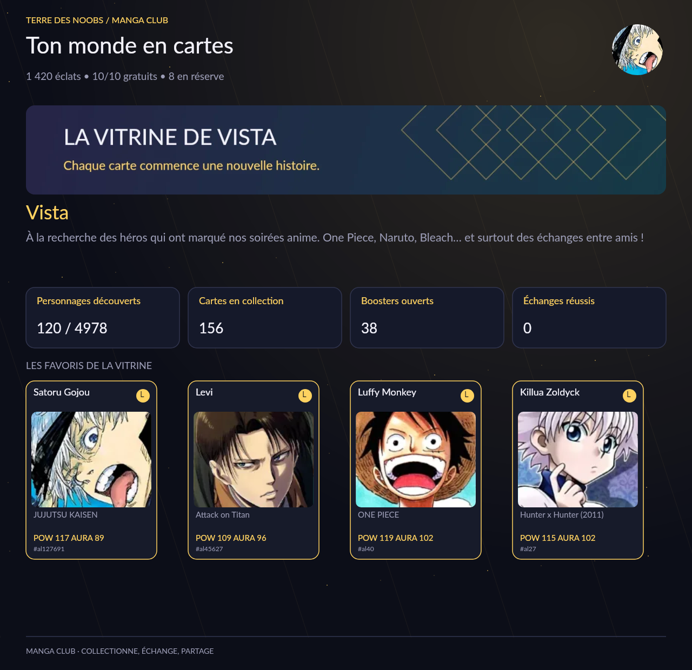
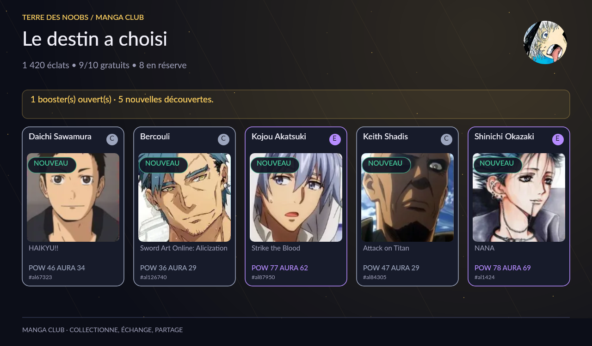
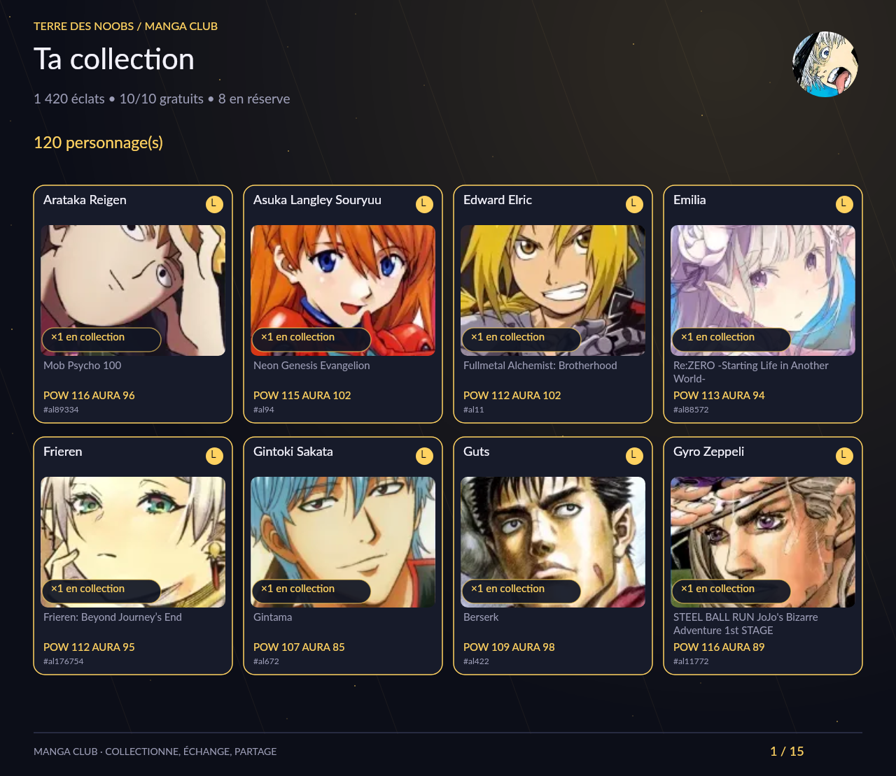
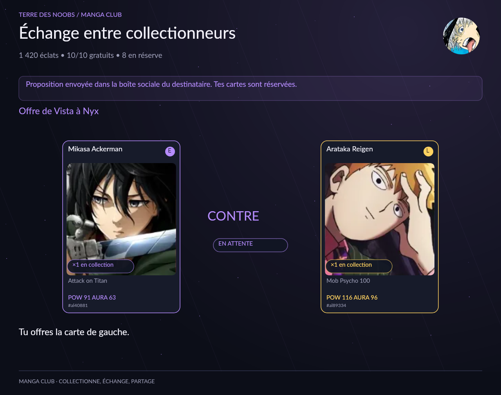

# Manga Club — version gacha

Cette version remplace l’interface et les interactions du RPG. Le déploiement Railway reste un service Discord Node.js avec PostgreSQL. La source des données est distincte de Kyara : aucune authentification Kyara ni copie de sa base n’est utilisée.

## Aperçus des menus

Les images ci-dessous proviennent du moteur Canvas réel, avec des données de démonstration isolées et les portraits embarqués. Aucun compte Discord réel n’est utilisé pour les produire.

L’annonce prête à copier est dans [annonces/gacha.txt](annonces/gacha.txt).

## Organisation du code

- `gacha-catalog.js` : catalogue statique, sources, six raretés, taux, prix, garanties et sélection des boosters.
- `gacha-game.js` : logique transactionnelle et vues de jeu. Documents `gacha_player`, `gacha_listing`, `gacha_trade`, `gacha_friend`, `gacha_confirm`, `gacha_receipt`, `gacha_search`, `gacha_import`, `gacha_media`.
- `gacha-controller.js` : sept commandes, contrôle d’identité, formulaires, visibilité, anti-double-clic et gestion des délais Discord. Les anciens identifiants `tdn`/`tdnp` sont refusés.
- `gacha-ui.js` : contrôles Discord, listes, boutons, navigation et pièces jointes PNG/GIF.
- `gacha-canvas.js` : composition graphique d’origine, cartes et portraits, bannière, vitrine et atlas WebP, avec cache limité à douze atlas.
- `gacha-animation.js` / `gacha-animation-worker.js` : détection des hauts rangs et encodage GIF dans un worker. Mythique : orbites roses/violettes ; légendaire : couronne et rayons dorés. Priorité au légendaire pour l’ambiance lorsqu’un tirage contient les deux. Jusqu’à cinq cartes sont mises en mouvement dans une même animation ; toutes les cartes du tirage restent affichées.
- `gacha-admin.js` : préparation et confirmation de reset, génération du profil, nettoyage des liens et audit. Les autorisations de serveur et d’administrateur sont contrôlées par le handler avant chaque appel ; ce module n’est jamais accessible au dispatch du jeu.

Une transaction PostgreSQL et le verrou consultatif partagé existant couvrent chaque dépense ou transfert. Les cartes en vente et celles proposées en échange sont retirées de l’inventaire et réservées dans le document correspondant. Elles reviennent exactement une fois à l’annulation, au refus ou à l’expiration. L’expiration est vérifiée avant les actions et dans le nettoyage périodique.

Les identifiants d’interactions Discord servent de reçus idempotents, conservés sept jours. Un replay réaffiche le résultat sans tirer d’autres cartes ni prélever un second coût. Les confirmations expirent après cinq minutes et revérifient état, quantité, prix, favoris, génération et destinataire. Les sessions de recherche liées à leur auteur expirent après une heure ; les demandes d’amis après sept jours. L’historique des échanges clos est conservé trente jours.

Les animations ne modifient jamais les cartes, compteurs de garantie ou paiements : elles interviennent après validation de la transaction. Elles sont encodées avec [gifenc](https://github.com/mattdesl/gifenc) (MIT), localement, sans FFmpeg ni service externe. Le GIF contient 32 images et dure 4,14 secondes, en lecture unique, à 960 pixels de large maximum. La première et la dernière image montrent le résultat complet ; les images intermédiaires utilisent la transparence pour conserver les cartes qui ne bougent pas. Un seul worker encode à la fois, la file est bornée à huit travaux, et un encodage est interrompu après douze secondes. Au-delà de 8 Mo, en cas de saturation ou d’erreur, le PNG complet est envoyé. La lecture automatique respecte les préférences Discord.

Les tests décodent réellement les GIFs avec `omggif` (dépendance de développement), vérifient le mouvement, la conservation des cartes, l’image finale et la taille, ainsi que l’ouverture de 25 cartes. La CI teste les deux workers dans le conteneur de production, sans dépendances de développement.

Les joueurs, marchés et relations sont globaux entre les serveurs du même bot, comme dans la version précédente. Le bot est destiné à une communauté : le verrou global et les listes de documents conviennent à cette échelle. Il ne s’agit pas d’une architecture pour des centaines de milliers de joueurs simultanés.

Toutes les nouvelles réponses Discord sont publiques (`flags: 0`), pour les commandes, listes, boutons, soumissions de formulaires, confirmations et erreurs. Chaque interaction crée une réponse distincte : un tirage déjà partagé n’est jamais remplacé par une navigation ultérieure. Un ancien panneau éphémère ouvre désormais une nouvelle réponse publique. Les contrôles personnels vérifient toujours l’auteur, et le reset conserve sa vérification du serveur et des permissions. La navigation `ga:all:nav` est limitée à la lecture et ouvre le carnet de la personne qui clique. Les fenêtres de formulaire restent intrinsèquement individuelles dans Discord.

## Catalogue

Import initial : **4 978 cartes**, **1 471 identifiants d’univers**, **4 978 portraits normalisés**, à partir de la fenêtre de 5 000 personnages les plus suivis accessibles dans l’API AniList. Les personnages dont les quatre premières œuvres liées ne fournissaient aucun anime/manga explicitement non adulte ont été écartés. Ce filtre ne constitue pas une classification par âge détaillée. Les différentes adaptations d’une franchise peuvent constituer des albums distincts.

Sources primaires : [API AniList](https://docs.anilist.co/), [objet Character](https://docs.anilist.co/reference/object/character) et chaque URL `source` enregistrée dans le catalogue. Les noms, noms de série, identifiants et images sont repris ; les descriptions éditoriales longues ne sont pas copiées. Les scores et raretés sont définis par le jeu, selon un classement initial par popularité dans chaque univers et une empreinte stable pour les scores.

Les portraits sont regroupés dans cinquante atlas WebP (10 × 10 cellules de 160 × 220), environ 36 Mo avec le JSON. Tous les fichiers sont inclus dans l’image Docker. Le site Kyara peut être indisponible sans empêcher de jouer ; AniList n’est contacté que lors d’un import explicite de construction.

`npm run catalog:import` utilise le cache local, conserve les identifiants, univers et raretés existants, et reconstruit tous les atlas. Une nouvelle fenêtre de popularité ne supprime pas les cartes déjà connues. Les taux dépendent de la présence d’une rareté, pas du nombre de personnages de cette rareté. Dans un univers ciblé, ils sont renormalisés ; la cinquième carte et les garanties ont des taux conditionnels distincts.

L’import n’est pas une synchronisation continue et ne couvre pas tous les mangas existants. Pour ajouter des personnages au-delà de la fenêtre de 5 000, il faudra étendre l’import par œuvres ou par identifiants en conservant les mêmes clés de carte. Ne pas remplacer les identifiants de cartes déjà distribuées.

## Exploitation

Conserver `DATABASE_URL`, `DISCORD_TOKEN`, `DISCORD_CLIENT_ID`, `DISCORD_GUILD_ID`, `REGISTER_COMMANDS=true`, `DEMO_MODE=false`. Aucun compte ni clé de service manga supplémentaire. La santé `/health` exige toujours Discord connecté et PostgreSQL joignable.

Le moteur RPG, ses vues, ses commandes, ses tests et ses ressources graphiques ont été supprimés du dépôt. Seuls les documents anciens de la base sont conservés. `gacha_import` mémorise la reprise initiale de la personnalisation et empêche qu’un reset de collection ne la réimporte automatiquement. Un retour à une ancienne révision Git retrouverait les sauvegardes RPG, sans effacer les documents gacha.

Les tests utilisent MemoryStore et des schémas PostgreSQL temporaires, sans connexion Discord. Le script `preview:gacha` produit vingt écrans réels dans `.local/gacha-previews/`, dont une ouverture de vingt-cinq cartes. La CI vérifie aussi les rendus dans l’image Linux de production.
