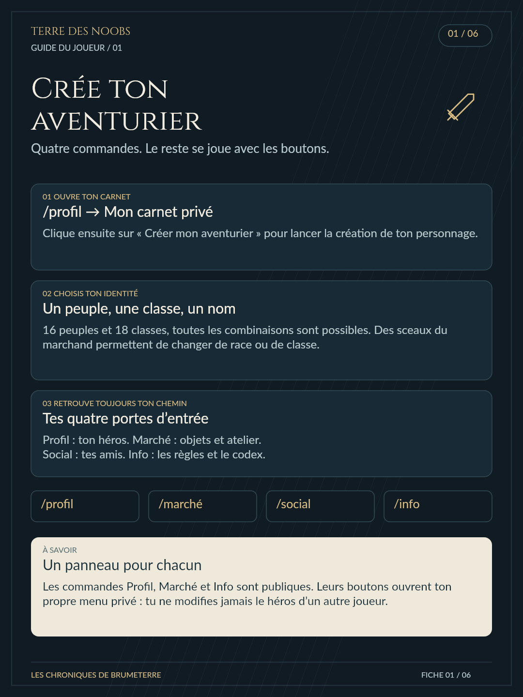
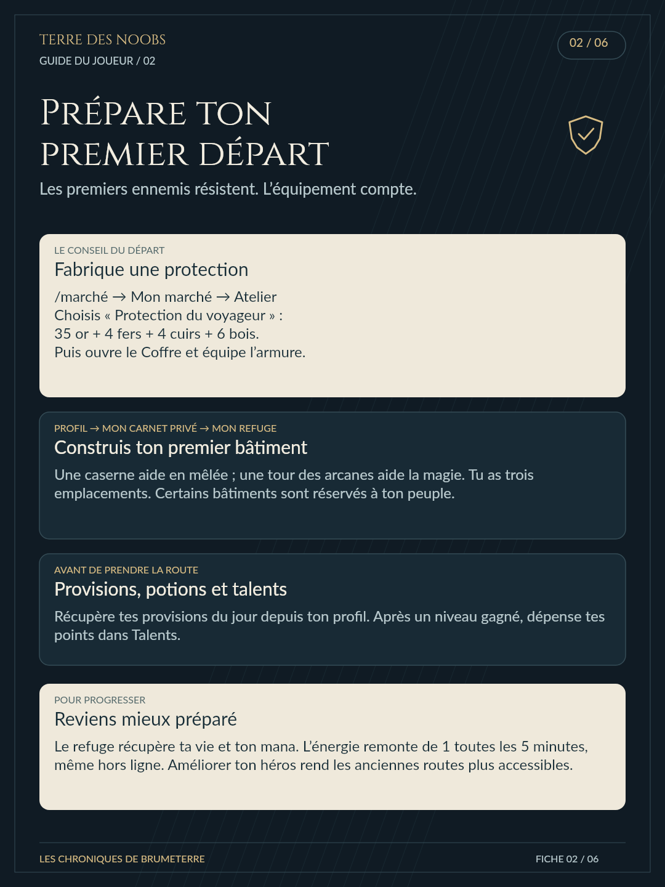
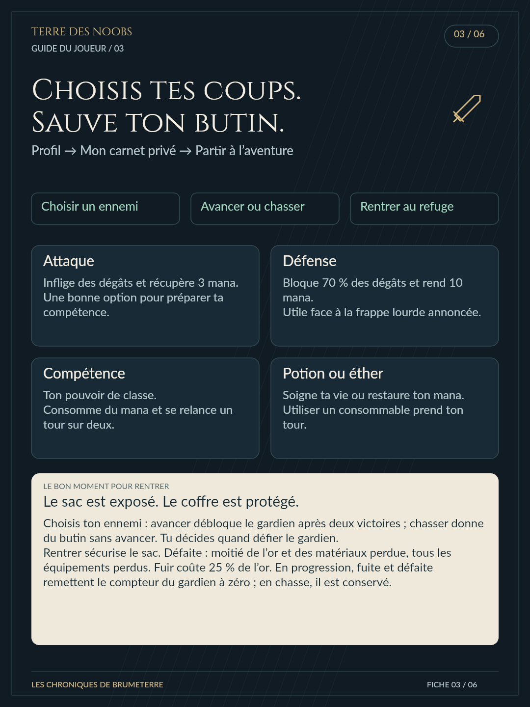
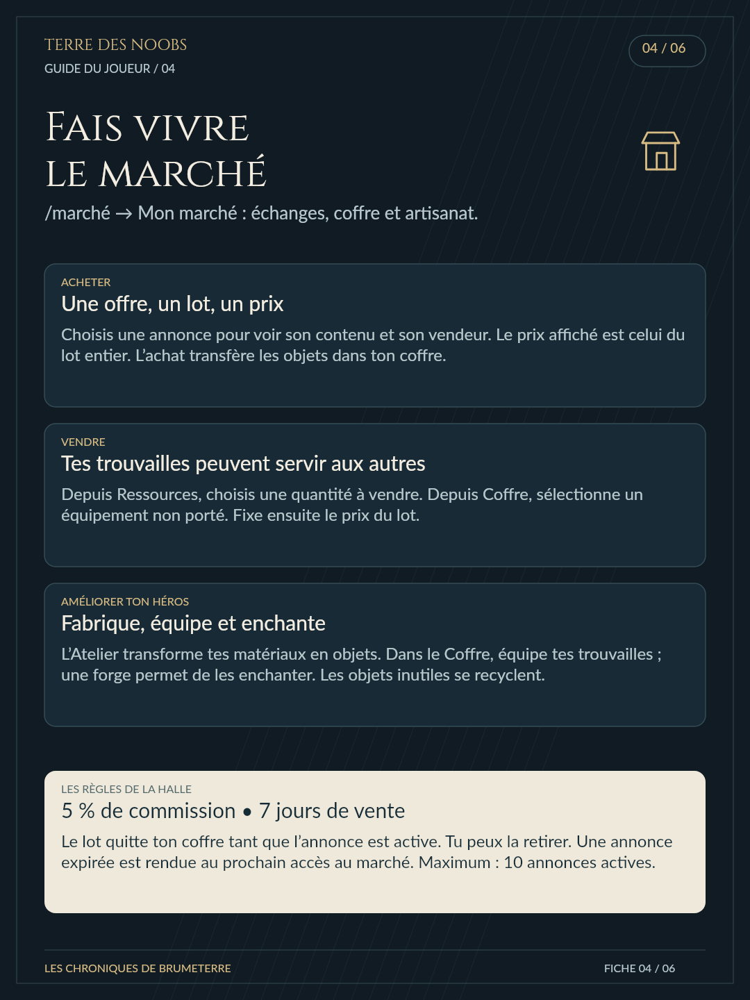
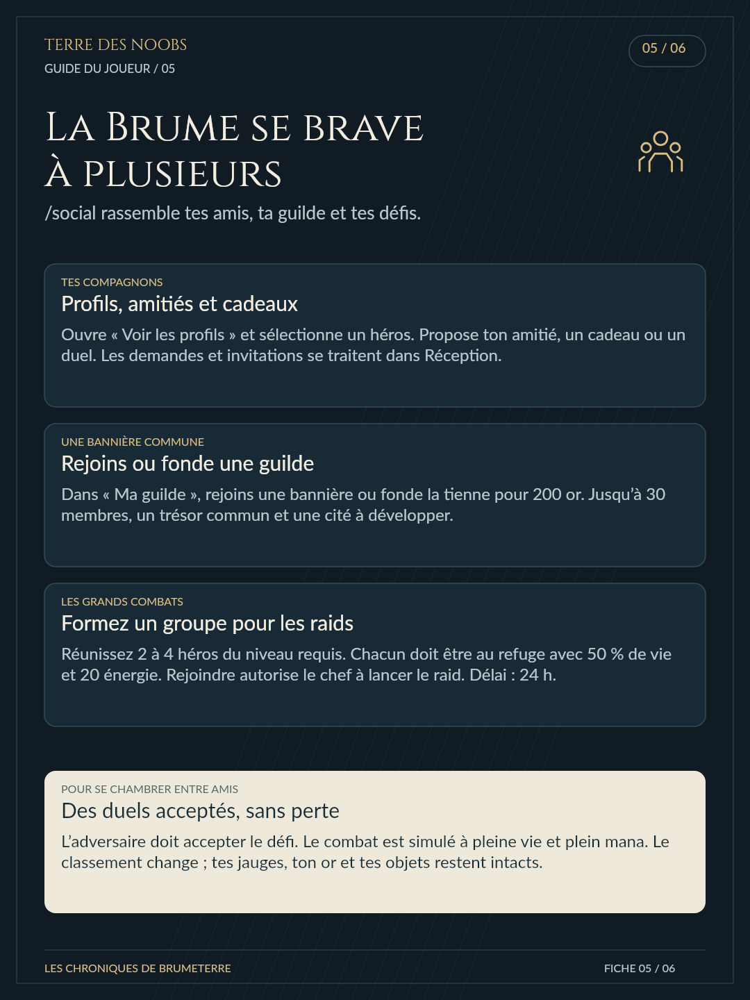
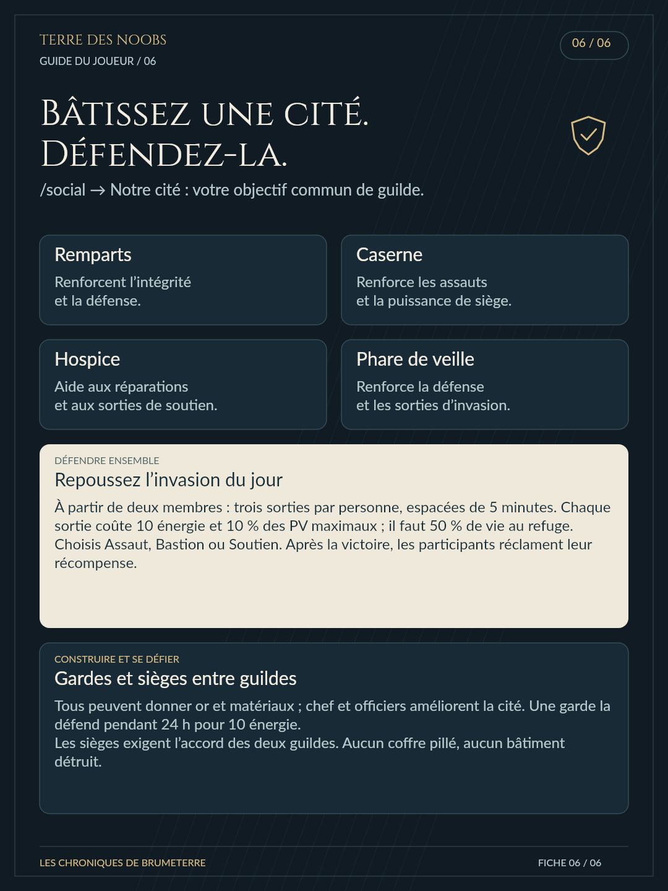

# Terre des Noobs — guide du joueur

Six fiches PNG de 1080 × 1440 pixels, à publier dans l’ordre dans un salon Discord. Le texte est retranscrit ci-dessous. Le message d’annonce est dans annonce-discord.txt.

Création graphique en Canvas, avec formes et pictogrammes vectoriels, sans illustration générée par IA. Les polices Cinzel et Lato sont celles du projet. Pour régénérer les images : npm run tutorial.

## 1. Crée ton aventurier

Quatre commandes. Le reste se joue avec les boutons.

### /profil → Mon carnet privé

Clique ensuite sur « Créer mon aventurier » pour lancer la création de ton personnage.

### Un peuple, une classe, un nom

16 peuples et 18 classes, toutes les combinaisons sont possibles. Des sceaux du marchand permettent de changer de race ou de classe.

### Tes quatre portes d’entrée

Profil : ton héros. Marché : objets et atelier.
Social : tes amis. Info : les règles et le codex.

### Un panneau pour chacun

Les commandes Profil, Marché et Info sont publiques. Leurs boutons ouvrent ton propre menu privé : tu ne modifies jamais le héros d’un autre joueur.

## 2. Prépare ton premier départ

Les premiers ennemis résistent. L’équipement compte.

### Fabrique une protection

/marché → Mon marché → Atelier
Choisis « Protection du voyageur » :
35 or + 4 fers + 4 cuirs + 6 bois.
Puis ouvre le Coffre et équipe l’armure.

### Construis ton premier bâtiment

Une caserne aide en mêlée ; une tour des arcanes aide la magie. Tu as trois emplacements. Certains bâtiments sont réservés à ton peuple.

### Provisions, potions et talents

Récupère tes provisions du jour depuis ton profil. Après un niveau gagné, dépense tes points dans Talents.

### Reviens mieux préparé

Le refuge récupère ta vie et ton mana. L’énergie remonte de 1 toutes les 5 minutes, même hors ligne. Améliorer ton héros rend les anciennes routes plus accessibles.

## 3. Choisis tes coups. Sauve ton butin.

Profil → Mon carnet privé → Partir à l’aventure

### Attaque

Inflige des dégâts et récupère 3 mana.
Une bonne option pour préparer ta compétence.

### Défense

Bloque 70 % des dégâts et rend 10 mana.
Utile face à la frappe lourde annoncée.

### Compétence

Ton pouvoir de classe.
Consomme du mana et se relance un tour sur deux.

### Potion ou éther

Soigne ta vie ou restaure ton mana.
Utiliser un consommable prend ton tour.

### Le sac est exposé. Le coffre est protégé.

Choisis ton ennemi : avancer débloque le gardien après deux victoires ; chasser donne du butin sans avancer. Tu décides quand défier le gardien.
Rentrer sécurise le sac. Défaite : moitié de l’or et des matériaux perdue, tous les équipements perdus. Fuir coûte 25 % de l’or. En progression, fuite et défaite remettent le compteur du gardien à zéro ; en chasse, il est conservé.

## 4. Fais vivre le marché

/marché → Mon marché : échanges, coffre et artisanat.

### Une offre, un lot, un prix

Choisis une annonce pour voir son contenu et son vendeur. Le prix affiché est celui du lot entier. L’achat transfère les objets dans ton coffre.

### Tes trouvailles peuvent servir aux autres

Depuis Ressources, choisis une quantité à vendre. Depuis Coffre, sélectionne un équipement non porté. Fixe ensuite le prix du lot.

### Fabrique, équipe et enchante

L’Atelier transforme tes matériaux en objets. Dans le Coffre, équipe tes trouvailles ; une forge permet de les enchanter. Les objets inutiles se recyclent.

### 5 % de commission • 7 jours de vente

Le lot quitte ton coffre tant que l’annonce est active. Tu peux la retirer. Une annonce expirée est rendue au prochain accès au marché. Maximum : 10 annonces actives.

## 5. La Brume se brave à plusieurs

/social rassemble tes amis, ta guilde et tes défis.

### Profils, amitiés et cadeaux

Ouvre « Voir les profils » et sélectionne un héros. Propose ton amitié, un cadeau ou un duel. Les demandes et invitations se traitent dans Réception.

### Rejoins ou fonde une guilde

Dans « Ma guilde », rejoins une bannière ou fonde la tienne pour 200 or. Jusqu’à 30 membres, un trésor commun et une cité à développer.

### Formez un groupe pour les raids

Réunissez 2 à 4 héros du niveau requis. Chacun doit être au refuge avec 50 % de vie et 20 énergie. Rejoindre autorise le chef à lancer le raid. Délai : 24 h.

### Des duels acceptés, sans perte

L’adversaire doit accepter le défi. Le combat est simulé à pleine vie et plein mana. Le classement change ; tes jauges, ton or et tes objets restent intacts.

## 6. Bâtissez une cité. Défendez-la.

/social → Notre cité : votre objectif commun de guilde.

### Remparts

Renforcent l’intégrité
et la défense.

### Caserne

Renforce les assauts
et la puissance de siège.

### Hospice

Aide aux réparations
et aux sorties de soutien.

### Phare de veille

Renforce la défense
et les sorties d’invasion.

### Repoussez l’invasion du jour

À partir de deux membres : trois sorties par personne, espacées de 5 minutes. Chaque sortie coûte 10 énergie et 10 % des PV maximaux ; il faut 50 % de vie au refuge.
Choisis Assaut, Bastion ou Soutien. Après la victoire, les participants réclament leur récompense.

### Gardes et sièges entre guildes

Tous peuvent donner or et matériaux ; chef et officiers améliorent la cité. Une garde la défend pendant 24 h pour 10 énergie.
Les sièges exigent l’accord des deux guildes. Aucun coffre pillé, aucun bâtiment détruit.

